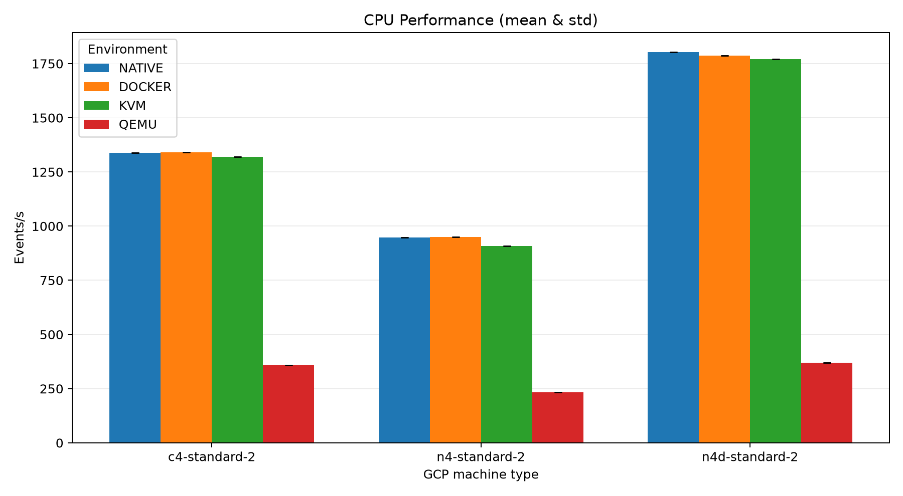
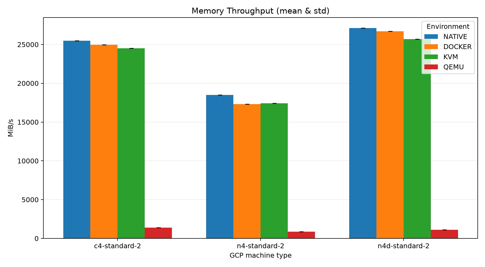
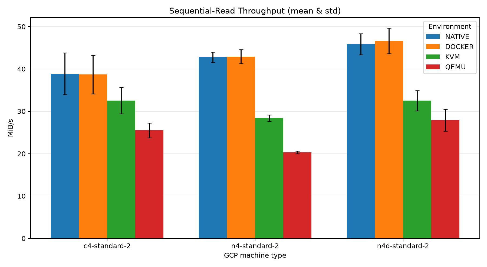

# Cloud Computing WiSe 2025 Practical Assignments

Practical assignments of the course "Cloud Computing" at TU Berlin, covering topics such as
- Google Cloud as an example of today's Infrastructure-as-a-Service clouds
- Benchmarking different virtualization technologies
- DevOps tasks for cloud services
- Infrastructure-as-code orchestration
- Container virtualization (Docker)
- Container-based orchestration (Kubernetes)

## Assignment 1: Virtualization Benchmarking

The goal of this assignment is to measure the performance overhead introduced by different virtualization technologies. We ran the same CPU, memory, and disk benchmarks in four execution environments on three different GCP VM configurations to understand how virtualization affects performance. We tested:

- Native Linux: Baseline performance without additional virtualization.
- Docker: Performance overhead of containerization.
- KVM: Performance overhead of hardware-assisted virtualization.
- QEMU: Performance overhead of software-based CPU emulation.

### Experimental Setup

1. Create 3 GCP VMs (`n4-standard-2`, `n4d-standard-2`, `c4-standard-2`) via [`create-vms.sh`](assignment1/create-vms.sh)
2. Run experiment via [`run-experiments.sh`](assignment1/run-experiments.sh), utilizing:
    - [`benchmarks.sh`](assignment1/benchmarks.sh): Runs 4 60-second Sysbench tests measuring single-threaded CPU prime-number calculations (up to 20,000), memory-read throughput using 4 KiB blocks, and random and sequential disk-read throughput using a 1 GiB test file with direct I/O.
    - [`start-native-linux-benchmarks.sh`](assignment1/start-native-linux-benchmarks.sh): Ensures Sysbench is installed on the GCP VM.
    - [`start-docker-benchmarks.sh`](assignment1/start-docker-benchmarks.sh): Installs/checks Docker, builds the Docker image and runs benchmark inside the Docker container.
    - [`start-kvm-benchmarks.sh`](assignment1/start-kvm-benchmarks.sh): Installs KVM and libvirt, prepares a QCOW2 disk, creates a nested Ubuntu VM with hardware acceleration and configures SSH and cloud-init. It then runs the benchmark via SSH inside the KVM guest.
   - [`start-qemu-benchmarks.sh`](assignment1/start-qemu-benchmarks.sh): Performs similar preparation as `start-kvm-benchmarks.sh` with the exception that it creates the nested Ubuntu VM without hardware acceleration. It then runs the benchmark via SSH inside the QEMU guest.
3. Analyze measurements and plot results via [`analyze_results.py`](assignment1/analyze_results.py)

### Results

<p float="left">
  
  
</p>

<p float="left">
  
  
</p>

## Assignment 2: OpenStack Deployment

In this assignment, we build our own small Infrastructure-as-a-Service (IaaS) cloud on top of three GCP VMs, acting as our physical servers.

### 1. Virtual Machines
- Run `spinup-gcp-for-openstack.sh` to create 2 VPC networks, 2 subnets and 3 VM instances named `controller`, `compute1`, `compute2` with machine type `n2-standard-2`.

### 2. OpenStack Setup
- Create a new Python environment within the `kolla_ansible_arc/` directory and run `pip install -r requirements.txt` (we tested it with Python 3.11.17).
- Inside `kolla_ansible_arc/`, replace the placeholders in `multinode` with respective values.
- cd into `kolla_ansible_arc/`, activate the new Python environment and run `ansible -m ping all -i ./multinode` to check whether ansible is setup correctly and the VMs are reachable.
- Execute the commands in `deploy-openstack.sh` manually one after another.

### 3. OpenStack Configuration
- Run `source admin-openrc.sh` to set environment variables that are used for authentication.
- Run `prepare-openstack.sh` to create a security group and a VM with floating IP.

## Assignment 3: Kubernetes Cluster

In this assignment, we use Kubernetes and Ansible to set up a small, distributed infrastructure of 
two interdependent HTTP services.

### 1. Virtual Machines
- Run `create-vms.sh` to create 3 VMs with machine type `n2-standard-2` and install the python-pip package on each VM.

### 2. Cluster Setup
- Clone the [Kubespray](https://github.com/kubernetes-sigs/kubespray) repository (We used the commit tagged with v2.32.0).
- Create a new Python environment next to the `kubespray/` folder, activate it and install the required packages using `pip install -r kubespray/requirements.txt`.
- In `hosts.yml`, replace the placeholders with respective external and internal IP addresses of the 3 VMs.
- Inside `kubespray/`, test the connectivity to the VMs by running `ansible -i ../hosts.yml all -m ping`.
- Inside `kubespray/`, run `export ANSIBLE_CONFIG=$(pwd)/ansible.cfg` and the playbook `ansible-playbook -i ../hosts.yml cluster.yml` to install the Kubernetes cluster on the 3 VMs, resulting in a 3-node cluster. Each node serves as both control plane and worker.

### 3. Deploy the application
- For frontend and backend deployment, build the corresponding Docker images, login in to Docker and push the images to Docker Hub: 
```bash
docker build -f backend.Dockerfile  -t <docker-username>/cc-backend:2.0  .
docker build -f frontend.Dockerfile -t <docker-username>/cc-frontend:2.1 .
docker login
docker push <docker-username>/cc-backend:2.0
docker push <docker-username>/cc-frontend:2.1
```
- Run the playbook `ansible-playbook -i hosts.yml webapp.yml` to let Kubernetes create 4 frontend and 6 backend pods. The backend's service type is ClusterIP, whereas the frontend's type is NodePort.
- To verify that the 10 pods are running, ssh to an arbitrary node:
```bash
ssh -i ~/.ssh/cc_ssh cc_student@<EXTERNAL_IP_OF_1_NODE> 
```
Then run:
```bash
sudo kubectl get pods -n cc-webapp
```

To further test the deployment, first figure out the frontend service's NodePort:
```bash
 ssh -i ~/.ssh/cc_ssh cc_student@<EXTERNAL_IP_OF_1_NODE> "sudo kubectl get svc cc-frontend-service -n cc-webapp -o jsonpath='{.spec.ports[0].nodePort}'"
```
- Use that port to run:
```bash
pip install requests
python3 test-deployment.py <node_ip1>:<port> <node_ip2>:<port> <node_ip3>:<port> | tee test-output.txt
```

## Assignment 4: Carbon-Aware Computing

To be done