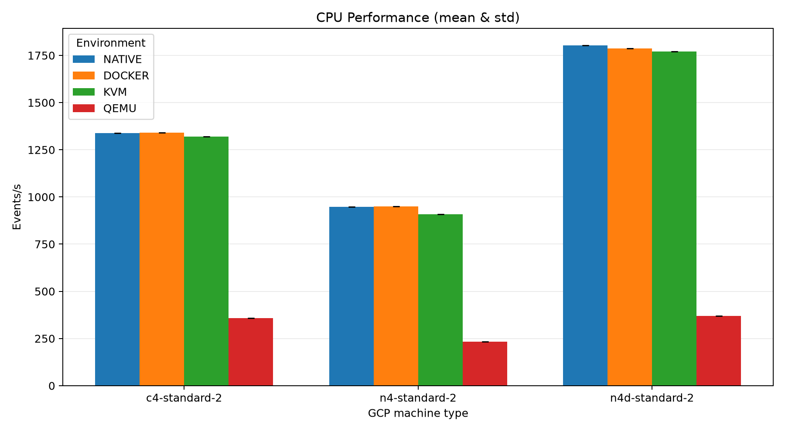
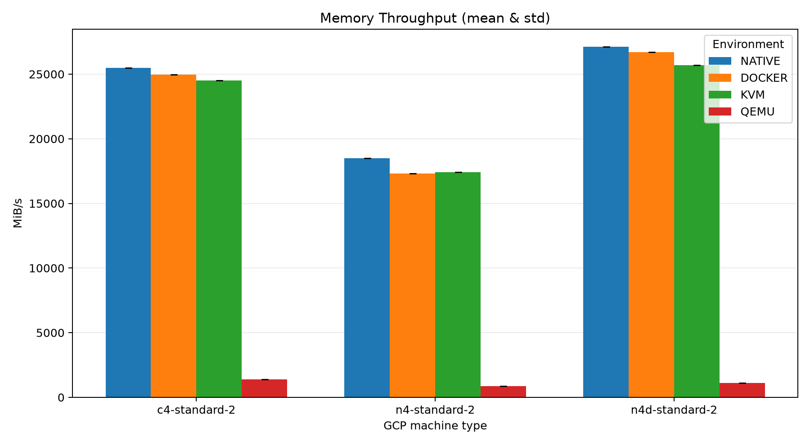
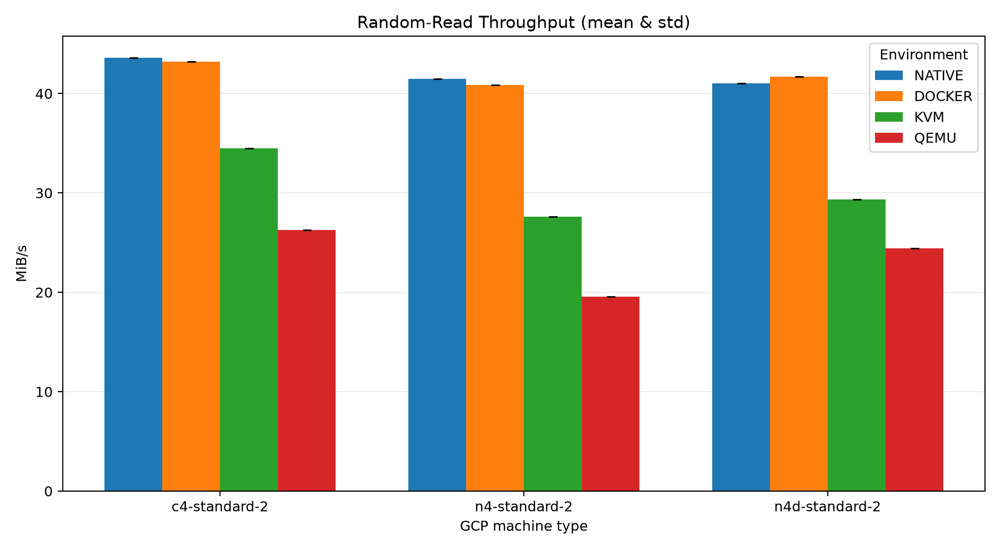
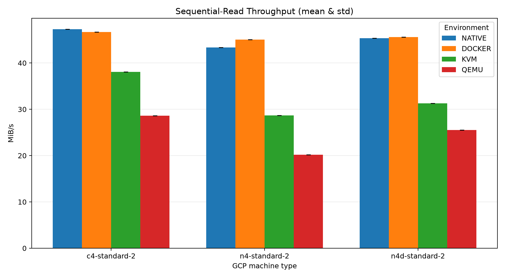

# Cloud Computing WiSe 2025/26 Practical Assignments

Practical assignments of the course "Cloud Computing" at TU Berlin, covering topics such as
- Google Cloud as an example of today's Infrastructure-as-a-Service clouds
- Benchmarking different virtualization technologies
- DevOps tasks for cloud services
- Infrastructure-as-code orchestration
- Container virtualization (Docker)
- Container-based orchestration (Kubernetes)

## Assignment 1: Virtualization Benchmarking

The goal of this assignment is to measure the performance overhead introduced by different virtualization technologies. We ran the same CPU, memory, and disk benchmarks in four execution environments on three different GCP VM configurations to understand how virtualization affects performance. We tested:

- Native Linux: Baseline performance without additional virtualization.
- Docker: Performance overhead of containerization.
- KVM: Performance overhead of hardware-assisted virtualization.
- QEMU: Performance overhead of software-based CPU emulation.

### Experimental Setup

1. Create 3 GCP VMs (`n4-standard-2`, `n4d-standard-2`, `c4-standard-2`) via [`create-vms.sh`](assignment1/create-vms.sh)
2. Run experiment via [`run-experiments.sh`](assignment1/run-experiments.sh), utilizing:
    - [`benchmarks.sh`](assignment1/benchmarks.sh): Runs 4 60-second Sysbench tests measuring single-threaded CPU prime-number calculations (up to 20,000), memory-read throughput using 4 KiB blocks, and random and sequential disk-read throughput using a 1 GiB test file with direct I/O.
    - [`start-native-linux-benchmarks.sh`](assignment1/start-native-linux-benchmarks.sh): Ensures Sysbench is installed on the GCP VM.
    - [`start-docker-benchmarks.sh`](assignment1/start-docker-benchmarks.sh): Installs/checks Docker, builds the Docker image and runs benchmark inside the Docker container.
    - [`start-kvm-benchmarks.sh`](assignment1/start-kvm-benchmarks.sh): Installs KVM and libvirt, prepares a QCOW2 disk, creates a nested Ubuntu VM with hardware acceleration and configures SSH and cloud-init. It then runs the benchmark via SSH inside the KVM guest.
   - [`start-qemu-benchmarks.sh`](assignment1/start-qemu-benchmarks.sh): Performs similar preparation as `start-kvm-benchmarks.sh` with the exception that it creates the nested Ubuntu VM without hardware acceleration. It then runs the benchmark via SSH inside the QEMU guest.
3. Analyze measurements and plot results via [`analyze_results.py`](assignment1/analyze_results.py)

### Results

  
  

  
  

## Assignment 2: OpenStack Deployment

To be done

## Assignment 3: Container Orchestration & Infrastructure-as-Code

To be done

## Assignment 4: Carbon-Aware Computing

To be done